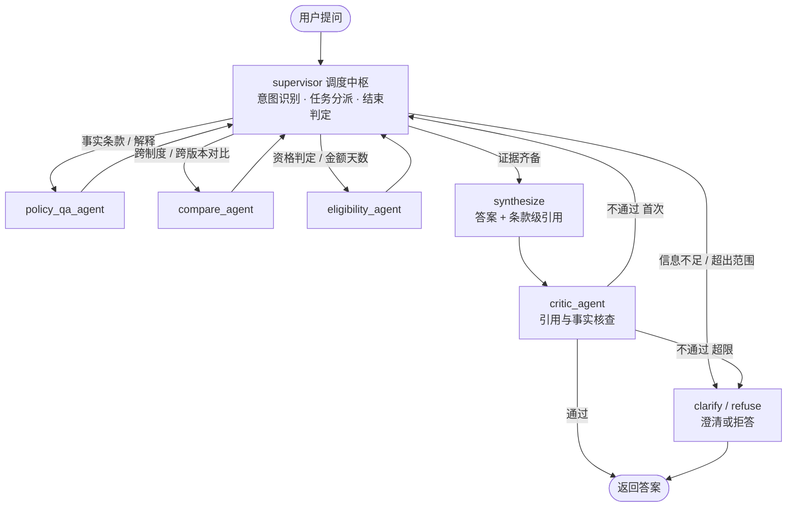
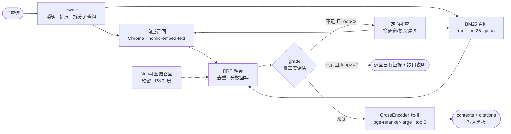

# 基于 LangGraph 与 RAG 的企业规章制度智能问答系统

> 面向企业内部制度文档的检索增强问答服务。用 LangGraph 编排一组各司其职的 Agent——调度中枢分派任务、领域专家各自检索与推理、审核 Agent 独立核查引用——让制度问答做到「答得准、引得出、不确定就说不知道」。

---

## 1. 项目定位

企业规章制度是企业内部最高频、也最容易问错的文档类型：假期、考勤、报销、薪酬、晋升、培训、奖惩——每份文件几十条条款，条款之间互相引用，同一件事往往横跨两三份文件才能答完。员工真实提问又高度口语化（"我干了 6 年，请病假能拿多少工资"），和制度原文的表述方式差得很远。

单靠检索或单轮 RAG 都不够用：

| 方案 | 问题 |
| --- | --- |
| 关键词搜索 / 全文检索 | 不理解语义，"病假工资"搜不到写着"疾病救济费"的条款；不知道要跨文件找 |
| 单轮向量 RAG | 只召回一次、召回到什么就答什么，召回不准时直接编造；无法处理跨条款、带阈值条件的复合问题 |
| 固定流程 RAG 管线 | 检索策略写死（永远 top-k 向量），面对"能/不能"类判断、"多少天"类计算、"那育儿假呢"类追问全部失效 |
| 单 Agent ReAct | 一个 Agent 挂满所有工具与规则，prompt 指令互相冲突；自己核查自己，幻觉难以发现；深层推理链失控 |

### 为什么拆成多个 Agent

制度问题在**推理模式**上并不是一类：

| 问题族 | 认知动作 | 需要的工具 |
| --- | --- | --- |
| 事实条款查询（"年假能跨年吗"） | 定位 → 摘录 → 复述 | 检索、按条款号取原文 |
| 跨制度/跨版本对比（"新版差旅和旧版差在哪"） | 双方取证 → 对齐 → 差异归纳 | 检索、版本列表、结构化对比 |
| 资格判定与计算（"工龄 6 年病假 10 天发多少"） | 找规则 → 提取阈值 → 计算 → 解释 | 检索、规则表、计算器 |

若由单一 Agent 承接三类问题，其 prompt 需同时约束三种不同的推理纪律，实际表现为指令相互稀释：应计算的场景只复述条款，应对比的场景只回答单侧。拆分后每个 Agent 的 prompt 只服务一种推理逻辑，工具集最小化，异常也能定位到具体环节。

同时多 Agent 带来两个工程收益：

- **上下文隔离**：每个专家只拿到"子任务描述 + 自己需要的那几条款"，不携带完整对话历史和别人的中间结果，token 与串味问题同时下降。
- **独立审核**：核查由不参与生成的 Agent 执行，且以规则校验为主、模型判断为辅，避免"自己检查自己"必然通过。

### 适用边界

多 Agent 架构的代价是路由误差放大、token 成本约为单 Agent 的 1.5~2 倍、首字延迟上升。系统的控制手段：只在推理模式存在实质差异处拆分；事实类问答（占比最高）由单一专家承接；调度与审核回环均设硬上限；调度中枢使用轻量模型。

---

## 2. 业务问题拆解

制度文本的四类难点，直接决定系统设计：

| 难点 | 典型问题 | 系统对策 |
| --- | --- | --- |
| **阈值与阶梯条件** | "工龄满 10 年不满 20 年，年假几天？" | 规则表查表 + 条款边界切分 + 父子块保证条款完整 |
| **跨文件、跨条款** | "出差期间生病，报销和病假怎么算？" | 调度中枢拆任务 → 多专家并行/串行取证 → 共享黑板合并 |
| **版本与时效** | 同一制度有 2022 版和 2025 版 | 元数据 `effective_date` / `status` 硬过滤；对比场景显式并列新旧两版 |
| **权限差异** | 管理层条款 vs 普通员工条款 | 元数据 `scope` 标签在检索入口过滤，越权条款不进入任何 Agent 上下文 |

两类"不能答错"的场景，必须显式支持：

- **知识库外问题**（"公司股票什么时候分红"）→ 明确拒答，不猜。
- **制度未覆盖**（"这个情况没规定"）→ 输出"制度未明确"+ 列出最相关条款供人工判断。

---

## 3. 系统架构

```
┌────────────────────────────────────────────────────────────────┐
│  接入层   Web 前端（SSE 流式 + 链路可视化） · REST API · OpenAPI   │
├────────────────────────────────────────────────────────────────┤
│  服务层   FastAPI：会话 · 鉴权 · 限流 · 反馈 · 埋点                │
├────────────────────────────────────────────────────────────────┤
│  编排层   LangGraph 顶层图：Supervisor 多 Agent 协作              │
│           supervisor ⇄ {qa / compare / eligibility} → synthesize │
│                                  → critic → END                 │
│           Checkpointer（多轮记忆 · 断点续跑 · 人工介入）           │
├────────────────────────────────────────────────────────────────┤
│  子图层   LangGraph 检索子图（各 Agent 共享的工具）                │
│           rewrite → 多路召回 → RRF 融合 → grade ⟲ → rerank        │
├────────────────────────────────────────────────────────────────┤
│  能力层   DocStore 共享黑板 · 规则表 · 计算器 · 引用校验器          │
├────────────────────────────────────────────────────────────────┤
│  数据层   向量(Chroma) │ BM25(内存·rank_bm25) │ MySQL │ Redis      │
├────────────────────────────────────────────────────────────────┤
│  模型层   DeepSeek 分级（flash/pro）· Embedding(nomic-embed-text) │
│           · Reranker(bge-reranker-large)                        │
└────────────────────────────────────────────────────────────────┘
```

> 图谱通道（Neo4j）本期不启用，但检索接口按"通道可插拔"设计：加一路 recall 只需实现 `BaseRetriever` 并在融合处注册，知识库侧的 `triple_extract.py` 留作 P8 扩展，不影响主流程部署。

两层图，职责边界清晰：

- **顶层图 = 多 Agent 协作**，解决"谁来回答、要不要多方取证、答案可不可信"。
- **检索子图 = Agentic RAG**，解决"这次该查哪些条款、查够了没有、怎么排"。
- 检索子图被所有专家以**工具**形式复用，一处优化全局受益；专家自带的是领域专属工具（规则表、计算器、版本列表）。

**离线链路**（建库、增量索引）与**在线链路**（每次提问跑图）完全解耦。

---

## 4. 多 Agent 协作编排（核心）

### 4.1 顶层拓扑



关键点：

- **supervisor 是循环枢纽**，不是一次性的路由器。专家返回后控制权回到中枢，它基于黑板里已有的证据决定"还差什么、再派谁、可以收口"。复合问题（"出差生病，报销和病假怎么算"）由此自然变成 `qa` 查病假规则 → `eligibility` 算工资 → 汇总，而不是硬塞给一个 Agent。
- **专家之间不直接通信**，只通过 supervisor 与共享黑板交换结果。避免点对点 handoff 形成的隐式调用网，链路始终可画出。
- **synthesize 与 critic 分离**：生成答案的人不负责判断答案可信；critic 只做核查，不做改写（改写由原专家在拿到反馈后完成，保证责任可追溯）。
- 所有回环带计数器：`dispatch_round ≤ 3`、`review_round ≤ 1`。超限直接降级为"部分回答 + 说明缺口"，绝不死循环。

### 4.2 Agent 清单

| Agent | 职责 | 专属工具 | 模型 |
| --- | --- | --- | --- |
| `supervisor` | 意图分类、子任务分解、专家分派、结束判定 | 无检索工具，只读黑板摘要 | 轻量（deepseek-v4-flash，低温度） |
| `policy_qa_agent` | 单点事实、条款解释、"能不能/是不是"判断 | `search`（检索子图）、`get_clause`、`get_doc` | 主模型 |
| `compare_agent` | 两份制度 / 新旧版本 / 两个岗位的差异对照 | `search`、`list_versions`、`get_clause` | 主模型 |
| `eligibility_agent` | 资格判定、天数/金额/审批层级推导 | `search`、`rule_table`、`calculator`、`get_clause` | 主模型（低温度） |
| `critic_agent` | 逐句核查答案是否被引用条款支撑、引用是否真实存在 | `check_citations`（规则）、`semantic_check`（句向量相似度） | 中等模型 + MiniLM |
| `synthesize` | 多专家结果合并、去重、统一引用编号与口径 | 无（纯文本编排 + 模板） | 轻量或模板 |

**每个专家都是独立的 ReAct 子图**（`create_agent` 构建：自带 system prompt、工具集、工具调用上限、模型）。这是"多 Agent"与"多节点"的分界：节点是一次函数调用，Agent 在自己的工具循环里自主决定调几次、调哪几个。

### 4.3 Agent 间通信

**① 控制流：`Command` 显式跳转**

```python
def supervisor_node(state: SupervisorState) -> Command[Literal[...]]:
    plan = decide_next(state)          # LLM + 结构化输出
    return Command(
        goto=plan.next,                 # "policy_qa_agent" | "eligibility_agent" | ...
        update={"plan": plan, "dispatch_round": state["dispatch_round"] + 1},
    )
```

`Command` 让"更新状态 + 决定下一跳"在一处完成，比"条件边 + 独立状态写入"更难写错。备选方案是官方 `langgraph-supervisor` 库，但它的 handoff 逻辑与 prompt 不可控，本项目选择自己画图。

**② 数据流：共享黑板 + 上下文投递**

```python
class SupervisorState(TypedDict, total=False):
    # 会话
    question: str
    session_id: str                    # Checkpointer 的 thread_id
    user_scope: list[str]              # ["employee"] / ["hr"] / ["manager"]
    history_summary: str               # 历史压缩摘要，不给原始消息流

    # 调度
    plan: dict                         # {subtasks: [{agent, goal, hint}], done: []}
    next_agent: str
    dispatch_round: int
    review_round: int

    # 黑板（并发写，需 reducer 去重合并）
    evidence: Annotated[list[dict], merge_evidence]   # 条款级证据池，全 Agent 共享
    agent_results: Annotated[list[dict], operator.add] # 各专家结论与置信度

    # 审核与产出
    review: dict                       # {verdict, unsupported[], bad_citations[]}
    final_answer: str
    citations: list[dict]

    # 观测
    trace: Annotated[list[dict], operator.add]         # 节点/工具事件，SSE 数据源
```

黑板的三条纪律：

1. **只放条款级证据（doc_id + 条款号 + 原文片段 + 来源通道 + 分数）**，不放整段对话，避免状态膨胀。
2. **按 `doc_id + article_no` 去重**，先写者胜；同一条款被两个专家查到只保留一份，标注命中的多个查询。
3. **谁写入谁标注用途**，synthesize 据此判断哪些证据真的被采用。

**③ 上下文隔离**

派活时 supervisor 只给目标 Agent 一个**子任务包**：`{goal, 已有关键结论, 需要什么证据}`，加上历史压缩摘要，**不给**其他专家的完整中间轨迹。这既降低 token，也防止专家被别人的错误结论带偏。需要完整证据时通过 `search` 重新检索（黑板里已有同一条款则直接复用，不重复走向量 + BM25 双路召回）。

### 4.4 审核与回退

`critic_agent` 不是让 LLM 自由评"好不好"，而是三步硬核查：

| 步骤 | 方式 | 输出 |
| --- | --- | --- |
| 引用真实性 | 规则：每个 `[E12]` 是否能在库中按 `doc_id + article_no` 命中 | 伪造/失效引用列表 |
| 逐句支撑 | 把答案拆句，与所引条款做句向量相似度比对（MiniLM，阈值按验证集校准），低于阈值的判为可疑 | 无支撑句列表 |
| 口径一致性 | 数字、天数、金额与引用条款原文比对（正则 + 单位归一） | 数值不符列表 |

判定：无支撑句 ≤ 10% 且有引用支撑 → pass；否则 reject，把 `review` 反馈回 supervisor，由它决定**打回原专家补证**（优先）还是**降级输出**（超限）。降级时答案保留已核实部分，并显式标注"以下内容制度未明确"。

---

## 5. 检索子图（Agentic RAG）

### 5.1 子图结构



这个子图是 **Agent 可调用的工具**（`search(query, mode)`），不是独立的说话者；它内部有自主回环，对外只暴露"给结果"。

### 5.2 双路召回（通道可扩展）

| 通道 | 实现 | 擅长 | 短板 |
| --- | --- | --- | --- |
| 向量 | Chroma + nomic-embed-text（768 维），HNSW | 语义近似、口语→书面 | 中文长尾词、精确数字与条款号弱 |
| BM25 | `rank_bm25.BM25Okapi` + jieba 分词，索引 pickle 落盘、进程内懒加载 | 条款号、专有名词、精确词 | 同义改写失效；元数据过滤需自己在回查时做 |
| 融合 | RRF（k=60），子类回写 `rrf_score` | 抹平两路分数量纲差异 | 两路都没召回时无解 |
| 图谱（预留） | Neo4j 三元组，Cypher 双向匹配 | 条件链、跨条款关系 | 本期不部署，接口占位 |

选型说明：本系统语料为"数份制度 × 每份数十条"的量级（条款总数数千条），BM25 全量载入内存约数十 MB。相比引入 Elasticsearch，可省去一个常驻 JVM 进程（约 1~2 GB）以及分词器与字段映射的维护成本；语料规模达到十万级条款时再评估外置索引。

- **召回与精排解耦**：两路结果先合并去重再统一精排，避免每路各自重排导致标准不一、重复计算；精排面向**原始问题**而非语义残缺的子问题。
- **父子块**：子块约 300 字建向量用于命中，命中回填父块约 1200 字送生成，避免条款被切断。
- **元数据硬过滤**：`status=active`、`effective_date <= today`、`scope ∈ user_scope` 三条件统一在 `store/filters.py` 实现；向量路下推为 Chroma `where`，BM25 路在拿到 `doc_id` 后回查 MySQL 元数据过滤，两路规则必须同源，否则会出现"向量能查到、BM25 查不到同一版本"的诡异现象。`compare_agent` 显式传 `include_archived=True` 才能看到旧版本。

### 5.3 精排

`bge-reranker-large`（CrossEncoder，HF 缓存位于 `G:/AI`，设 `HF_HUB_OFFLINE=1` 离线加载）打分，输入 `(原始问题, 条款原文)`，取 top 6。模型与 Chroma client 均为**进程内单例懒加载**，避免每条请求新建实例导致的 C 扩展累积与内存泄漏。

内存预算：large 版参数 560M，CPU fp32 推理常驻约 2~2.5GB，`batch_size=8`、`max_length=512` 足够覆盖条款长度。若与本地其他服务抢内存，可临时降到 `bge-reranker-base`（约 1.1GB），接口不变。

---

## 6. 辅助能力层

| 能力 | 服务对象 | 说明 |
| --- | --- | --- |
| `DocStore` 共享黑板 | 全部 Agent | 候选池统一去重、保留来源与原始分数、支持按条款号取回原文 |
| 规则表 `rule_table` | eligibility | 建库时把"工龄区间→年假天数""病假时长→工资比例"抽成结构化表（JSON/MySQL），避免每次靠 LLM 从条款里重算 |
| 计算器 `calculator` | eligibility | 受限求值（只允许四则、比较、取整），显式单位归一（天/月/元/%），结果必须回填引用的规则表条目 |
| 引用校验器 `check_citations` | critic | 按 `doc_id + article_no` 回库比对，识别伪造引用与失效版本 |
| 条款归一 | 全链路 | 条款号统一为 `《制度名》第12条`，供引用、去重、前端跳转共用 |

---

## 7. 知识库构建

```
多格式文档 → 解析 → 清洗 → 条款级切分 → 父子块 → 规则表抽取 → 双路索引
 (PDF/Word/MD) (文本+页码)   (章/条边界)              (JSON/MySQL) (Chroma + BM25)
```

1. **解析**：PDF/Word/MD 转统一中间结构，保留页码与标题层级；扫描件走 OCR（视语料而定）。
2. **清洗**：去页眉页脚、修订说明、目录冗余；统一全半角与数字格式。
3. **切分**：优先按"章/条"边界切，条款编号作强边界；超长条款父子二段切。每条 clause 携带 `title / chapter / article_no / page / effective_date / version / scope`。
4. **规则表抽取**：识别"阶梯/比例/上限/门槛"类条款，抽成 `{条件区间, 结论值, 依据条款}` 结构化行，供 `eligibility_agent` 查表 + 计算。无明确依据的条目不进表——宁可查不到，不能算错。
5. **索引写入**：按内容 hash 去重；重新上传即覆盖旧版并把旧版置 `archived`，不物理删除。Chroma 存子块向量，MySQL 存 clause 元数据（元数据主库，避免向量库和关系库各存一份真相）。
6. **BM25 索引产物**：`{doc_id → 分词后的子块 tokens + 原文引用}`，pickle 落盘并带 `index_version`；重建时先写 `.tmp` 再原子 rename，避免重建中途服务读到半截索引。
7. **图谱（预留）**：`ingest/triple_extract.py` 保留实现骨架，P8 启用时新增一路召回并在融合处注册，主流程与配置不改。

---

## 8. 技术栈

| 层 | 选型 | 说明 |
| --- | --- | --- |
| 语言/框架 | Python 3.11 · FastAPI · Pydantic v2 | 异步优先，SSE 原生支持 |
| 编排 | **LangGraph**（StateGraph / Command / 子图 / Checkpointer / Send） | 核心：顶层多 Agent 图 + 检索子图 |
| Agent 构建 | LangChain `create_agent`（每个专家一个 ReAct 子图） | 专家自主性来源 |
| LLM 应用 | LangChain（prompt / structured output / retriever 抽象） | 只做组件，不接管编排 |
| 大模型 | DeepSeek（OpenAI 兼容接口）：`deepseek-v4-flash` 作 supervisor / critic 与常规专家，`deepseek-v4-pro` 作难例与跨版本对比 | 分级调用控成本，不占本地内存 |
| Embedding | nomic-embed-text（Ollama 本地，768 维） | 已本地就绪、零调用成本；中文能力见风险表 |
| 向量库 | Chroma（Docker 部署，HTTP client） | 轻量，支持 `where` 下推过滤 |
| 稀疏检索 | `rank_bm25` + jieba（进程内，pickle 持久化） | 免 ES，省 1~2GB 常驻内存 |
| 图谱 | Neo4j 5（**预留，不部署**） | P8 扩展位，接口已占 |
| 精排 | bge-reranker-large（CrossEncoder，HF 缓存 `G:/AI`） | 本地离线推理 |
| 核查 | 句向量相似度（`paraphrase-multilingual-MiniLM-L12-v2`）+ 正则规则 | 低成本替代 NLI，避免 LLM 自评偏袒 |
| 关系库 | MySQL 8（Docker 部署） | 用户、文档元数据、规则表、会话、反馈 |
| 缓存 | Redis（外部 URL 或 Docker） | 路由/检索缓存、限流；Checkpointer 后端 |
| 前端 | 原生 HTML/CSS/JS + EventSource | 重点做 Agent 链路可视化 |
| 部署 | Docker Compose（chroma + mysql + redis），应用本机运行 | 依赖容器化，模型走本机缓存 |
| 评估 | RAGAS + 自建测试集 + 消融脚本 | 见第 11 节 |

选型原则：**能在本机跑的坚决不占本地内存，能调 API 的不本地部署 LLM**。整套依赖的常驻内存目标是压到 8GB 以内（Chroma + MySQL + Redis 约 1.5~2GB，reranker 约 2.5GB，其余为应用与 Python 进程）。

---

## 9. 目录结构

```
policymind/
├── app/
│   ├── main.py
│   ├── api/
│   │   ├── chat.py              # SSE 问答
│   │   ├── kb.py                # 上传 / 重建索引 / 文档列表
│   │   └── feedback.py          # 反馈与纠错
│   ├── agents/                  # 每个 Agent 一个 ReAct 子图
│   │   ├── supervisor.py        # 调度中枢（Command 路由）
│   │   ├── policy_qa.py
│   │   ├── compare.py
│   │   ├── eligibility.py
│   │   └── critic.py
│   ├── graph/
│   │   ├── state.py             # SupervisorState / RetrievalState
│   │   ├── supervisor_graph.py  # 顶层图组装 + checkpointer
│   │   └── retrieval_graph.py   # 检索子图
│   ├── retrieval/
│   │   ├── vector.py  bm25.py  filters.py
│   │   ├── fusion.py            # RRFEnsembleRetriever（分数回写）
│   │   └── reranker.py          # CrossEncoder 单例（bge-reranker-large）
│   ├── ingest/
│   │   ├── loader.py  cleaner.py  splitter.py
│   │   ├── rule_extract.py      # 阶梯/比例条款 → 规则表
│   │   ├── triple_extract.py    # 预留：Neo4j 三元组（P8）
│   │   └── pipeline.py
│   ├── llm/
│   │   ├── client.py            # 分级模型
│   │   └── prompts/             # 每个 Agent 独立 prompt 目录
│   ├── tools/
│   │   ├── search_tool.py  clause_tool.py  version_tool.py
│   │   ├── rule_tool.py  calc_tool.py  cite_check_tool.py
│   ├── store/
│   │   ├── docstore.py          # 共享黑板
│   │   └── mysql.py  redis.py  chroma.py   # neo4j 预留，es 不引入
│   └── core/
│       ├── config.py  logger.py  security.py  metrics.py
├── scripts/
│   ├── ingest_all.py
│   ├── eval_routing.py          # 调度准确率
│   ├── eval_retrieval.py        # 检索层指标
│   └── eval_rag.py              # RAGAS + 消融
├── eval/
│   ├── dataset.jsonl
│   └── reports/
├── web/
├── data/
├── docker-compose.yml           # chroma + mysql + redis
├── requirements.txt
├── .env                         # 本地实际配置（不入库）
├── .env.example                 # 变量模板（入库）
├── .gitignore
└── README.md
```

---

## 10. 接口与流式协议

### `POST /api/chat/stream`

```json
{
  "session_id": "s-20261106-001",
  "question": "我工龄6年，请病假10天工资怎么发",
  "user_scope": ["employee"]
}
```

SSE 事件与图事件一一对应，前端据此画 Agent 链路：

| event | data 关键字段 | 说明 |
| --- | --- | --- |
| `route` | `intent`, `plan[]` | 调度中枢识别的意图与子任务 |
| `agent_start` / `agent_end` | `agent`, `goal`, `elapsed_ms` | 专家开始/结束某子任务 |
| `tool` | `agent`, `tool`, `query`, `hits` | 工具调用（含检索子图内部通道） |
| `retrieve` | `source`, `count`, `elapsed_ms` | 每路召回完成推一条 |
| `grade` | `coverage`, `missing`, `loop` | 召回质量与缺口 |
| `rerank` | `top_k`, `items[]` | 精排后条款 |
| `token` | `text` | 答案增量 |
| `citation` | `title`, `article_no`, `page`, `snippet` | 条款级引用 |
| `review` | `verdict`, `unsupported[]` | 核查结论 |
| `done` | `latency_ms`, `token_usage`, `agents_used[]` | 结束 |

其他：`POST /api/kb/upload`（异步索引，返回 task_id）、`POST /api/kb/reindex`、`GET /api/kb/docs`、`POST /api/feedback`。

---

## 11. 评估方案

三层评估，避免"只能靠感觉说效果好"。

### 11.1 测试集

自建 80~100 题，按**问题族**标注（与 Agent 分工对齐）：

| 类型 | 占比 | 期望路由 | 示例 |
| --- | --- | --- | --- |
| 单条款事实 | 40% | `policy_qa` | "年假可以跨年休吗" |
| 跨条款/跨文件 | 25% | `policy_qa`（多轮）或 `qa`+`eligibility` | "出差期间生病，病假和差旅报销怎么算" |
| 阈值计算 | 20% | `eligibility` | "工龄 12 年，病假 3 个月工资多少" |
| 版本对比 | 5% | `compare` | "2025 版差旅标准和 2022 版有何不同" |
| 应拒答 | 10% | `refuse` | "公司股票分红时间" |

每题标注：标准答案、支撑条款 ID、期望 Agent、子任务数。

### 11.2 指标

| 层 | 指标 |
| --- | --- |
| 调度层 | 路由准确率（选对专家）、任务分解完整率（是否漏派）、多派率（是否过度分派） |
| 检索层 | Recall@5 / Recall@10、MRR、Context Precision |
| 生成层 | RAGAS：Faithfulness、Answer Relevancy、Context Recall |
| 审核层 | 核查召回率（有问题的答案被拦下的比例）、误拦率 |
| 系统层 | 端到端准确率、P50/P95 延迟、平均 token 成本、回环触发率、拒答准确率 |

### 11.3 消融实验

| 组 | 配置 | 验证什么 |
| --- | --- | --- |
| A | 纯向量 top-5，单 Agent 单轮 | 基线 |
| B | 向量 + BM25 + RRF | 混合召回收益 |
| C | B + 父子块 + 查询改写 | 分块与改写对长条款、口语化问题的增益 |
| D | C + CrossEncoder（large） | 精排收益 |
| E | D + grade 回环（单 Agent） | Agentic 检索的收益 |
| F | E + supervisor 多 Agent | **多 Agent 拆分本身的收益**（对比单 Agent 挂全套工具） |
| G | F + critic 核查 | 幻觉抑制收益 |
| H（P8 预留） | F + Neo4j 图谱通道 | 图谱通道的边际收益，用于判断是否值得引入 |

每组在同测试集上运行，输出对比表与失败案例归类（路由错 / 召回缺 / 计算错 / 引用伪造 / 拒答误判）。F 组用于验证多 Agent 拆分的实际收益，需单独成表。

---

## 12. 实施阶段

| 阶段 | 范围 | 交付 |
| --- | --- | --- |
| P0 骨架 | 目录、配置、Docker Compose、MySQL/Redis 表结构 | 服务能起，`/health` 通过 |
| P1 建库 | 解析→清洗→条款切分→Chroma 向量索引 + BM25 索引→双路检索 | `ingest_all.py` 跑通 |
| P2 单 Agent 基线 | 一个 QA Agent + 检索工具 + SSE + 前端最小页 | 端到端可答（消融 A/B 组） |
| P3 检索子图 | rewrite/多路/RRF/grade 回环/精排，封装为工具 | 检索子图独立可测（C/D/E 组） |
| P4 多 Agent | supervisor + qa/compare/eligibility + 黑板 + Command 路由 | 链路可视化（F 组） |
| P5 审核闭环 | critic + 引用校验 + 句向量核查 + 回退策略 | G 组，拒答与降级可用 |
| P6 工程化 | 权限过滤、版本时效、Redis 缓存、限流、埋点、规则表 | 可部署演示 |
| P7 评估 | 测试集、RAGAS、消融报告 | 评估报告 + 失败分析 |
| P8 扩展（可选） | Neo4j 图谱通道 + H 组实验 | 图谱增益结论 |

P2 阶段先实现单 Agent 基线：它既是消融实验的对照组，也为多 Agent 拆分提供可量化的比较基准。

---

## 13. 部署与配置

### 13.1 依赖拓扑

```
本机（Windows）                          Docker                     外部
├─ FastAPI / uvicorn  :8000            ├─ chromadb  :8001→8000    ├─ DeepSeek API
├─ Ollama             :11434           ├─ mysql     :3306          └─ Redis（外部 URL 或容器）
│  └─ nomic-embed-text                  └─ redis     :6379（可选）
├─ bge-reranker-large（HF 缓存 G:/AI，进程内）
└─ BM25 索引 data/index/bm25_index.pkl
```

Chroma 容器内监听 8000，与本机 FastAPI 的 8000 冲突，因此**宿主机映射到 8001**，`.env` 里 `CHROMA_PORT=8001`。不引入 Elasticsearch 与 Neo4j，省掉的正是两个最吃内存的常驻服务。

### 13.2 启动顺序

```bash
# 1. 依赖容器
docker compose up -d                # chroma / mysql / redis

# 2. 本地模型服务
ollama serve                        # 或已自启；确认 ollama list 里有 nomic-embed-text

# 3. 环境变量（Windows bash 下）
export HF_HOME=G:/AI
export HF_HUB_OFFLINE=1

# 4. 建库（首次 / 文档更新后）
python scripts/ingest_all.py --rebuild

# 5. 起服务
uvicorn app.main:app --reload --host 0.0.0.0 --port 8000
```

`/health` 需同时探活五项：MySQL、Redis、Chroma、Ollama embedding、BM25 索引文件。任一项不可用时，问答链路会在检索阶段发生静默降级，健康检查应能暴露这类问题。

### 13.3 环境变量

完整清单见 `.env.example`，关键分组：

| 分组 | 变量 | 说明 |
| --- | --- | --- |
| 大模型 | `DEEPSEEK_API_KEY` / `LLM_MODEL_MAIN` / `LLM_MODEL_EXPERT` | key 本地填；模型名按账号实际开放的名称调整 |
| Embedding | `OLLAMA_BASE_URL` / `EMBEDDING_MODEL` / `EMBEDDING_DIM` | 维度必须与 Chroma collection 一致（nomic-embed-text = 768） |
| 精排 | `HF_HOME` / `HF_HUB_OFFLINE` / `RERANKER_MODEL` | 离线加载，避免启动时联网校验卡住 |
| 向量库 | `CHROMA_HOST` / `CHROMA_PORT` / `CHROMA_COLLECTION` | 换嵌入模型必须换 collection |
| 关系库 | `DATABASE_URL` | MySQL 容器初始化时同步创建库与用户 |
| 缓存 | `REDIS_URL` / `CHECKPOINT_BACKEND` | Checkpointer 与业务缓存共用实例，键前缀隔离 |
| 检索 | `RETRIEVAL_TOP_K` / `RRF_K` / `GRADE_MIN_COVERAGE` | 消融实验通过改这几个值复现不同组 |
| 编排 | `MAX_DISPATCH_ROUND` / `MAX_REVIEW_ROUND` / `MAX_RETRIEVAL_LOOP` | 回环硬上限，防止成本失控 |


