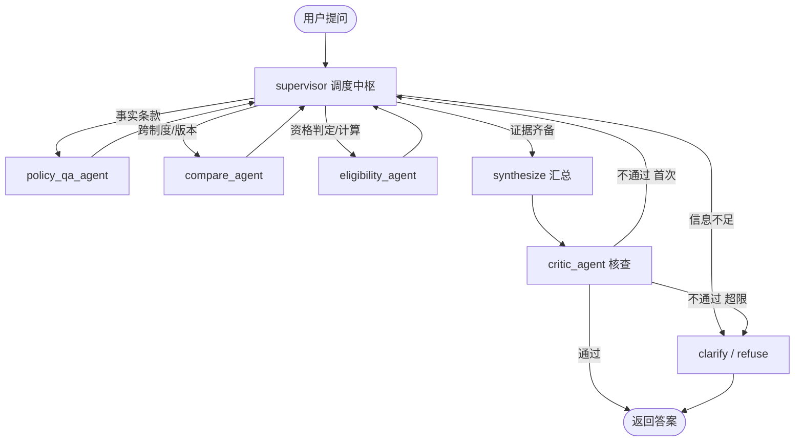

# multi-agent--RAG

***（此项目绝大多数代码由Hermes Agent，T3 Code和Claude生成，目前处于debug阶段，仅用作学习）***

面向企业内部制度文档的检索增强问答服务。员工用自然语言提问（"工龄 6 年请病假，工资怎么算"），系统在制度库中定位相关条款，组织答案并逐句标注引用来源；知识库没有依据时明确拒答，不编造。

系统采用 LangGraph 编排多 Agent 协作：调度中枢按问题类型分派给领域专家，专家共享一条带质量评估回环的检索子图，生成结果由独立 Agent 核查引用真实性后才返回。

## 功能概览

- **制度问答**：条款解释、事实查询、"能不能 / 是不是"判断，答案带条款级引用
- **多专家协作**：事实问答、跨版本对比、资格计算分派给不同专家，复合问题多轮取证后汇总
- **混合检索**：向量（Chroma）与 BM25 双路召回，RRF 融合，CrossEncoder 精排
- **检索自检**：召回质量不达标时自动换通道补查，最多两轮
- **答案核查**：引用真实性与逐句支撑度独立核查，不通过则回退重生成或降级
- **可控边界**：版本时效、角色权限在检索入口硬过滤；无依据时拒答
- **前端文档入库**：管理员可在页面直接上传 PDF / DOCX / MD / TXT，自动解析、切分并写入 MySQL + Chroma + BM25；每次入库写入台账（doc_id / 来源文件 / 操作人 / 时间 / 动作），并用文件 checksum + 正文指纹识别重复与内容变更；面板实时显示任务、文档列表与入库记录（4 级用户只读可见）
- **轻量交互**：寒暄 / 感谢 / 告别等纯闲聊直接短回复；天气、时间、新闻、娱乐、编程、数学等非制度问题也直接说明能力边界，不触发检索；只有包含制度关键词或需要制度依据的问题才走检索。最终答案默认控制在 150~500 字，专家中间稿不再流式显示

## 系统框架

```
接入层   Web 前端（SSE + 链路可视化） · REST API
服务层   FastAPI：会话 · 鉴权 · 限流 · 反馈
编排层   LangGraph 顶层图：supervisor ⇄ 专家 → synthesize → critic
子图层   检索子图：rewrite → 双路召回 → RRF → grade ⟲ → rerank
能力层   DocStore 黑板 · 规则表 · 计算器 · 引用校验
数据层   Chroma · BM25（内存） · MySQL · Redis
模型层   DeepSeek（flash/pro）· nomic-embed-text · bge-reranker-large
```

**多 Agent 协作**



**检索子图**：`rewrite`（指代消解 / 术语扩展 / 子问题拆分）→ 向量与 BM25 并行召回 → RRF 融合去重 → `grade` 判断覆盖度，不足则定向补查 → CrossEncoder 精排取 top 6 → 证据写入共享黑板。该子图封装为 `search` 工具，供所有专家复用。

**技术栈**

| 层 | 选型 |
| --- | --- |
| 后端 | Python 3.11 · FastAPI · Pydantic v2 |
| 编排 | LangGraph（StateGraph / Command / 子图 / Checkpointer） |
| Agent | LangChain `create_agent` |
| 大模型 | DeepSeek `deepseek-flash` / `deepseek-v4-pro` |
| Embedding | nomic-embed-text（Ollama，768 维） |
| 向量库 | Chroma |
| 稀疏检索 | rank_bm25 + jieba |
| 精排 | bge-reranker-large |
| 存储 | MySQL 8 · Redis |
| 部署 | Docker Compose + 本机 Python |

## 本地部署

### 环境要求

| 项 | 要求 |
| --- | --- |
| 操作系统 | Windows 10/11（Linux 亦可） |
| Python | 3.11+（推荐 uv 管理） |
| Docker Desktop | 运行 Chroma、MySQL、Redis |
| Ollama | 已拉取 `nomic-embed-text` |
| 内存 | ≥ 16 GB（Docker 依赖约 2 GB，精排模型约 2.5 GB） |
| 磁盘 | HF 缓存目录预留 ≥ 5 GB |

### 1. 安装依赖

```bash
uv venv && source .venv/Scripts/activate
uv pip install -r requirements.txt
```

### 2. 启动依赖容器

```bash
docker compose up -d          # chroma / mysql / redis
docker compose ps             # 确认三个容器 healthy
```

Chroma 容器内监听 8000，宿主机映射到 **8001**，避免与本机 FastAPI（8000）冲突。

### 3. 准备本地模型

```bash
ollama serve                  # 若未开机自启
ollama list                   # 确认存在 nomic-embed-text
```

精排模型从本地 HF 缓存加载。`app/core/config.py` 会在第三方库 import 前自动把 `.env` 中的 `HF_HOME` / `HF_HUB_OFFLINE` 写入进程环境变量，无需手动 export；如需联网下载模型，把 `HF_HUB_OFFLINE` 设为 `0`。

也可以手动设置（可选）：

```bash
export HF_HOME=G:/AI
export HF_HUB_OFFLINE=1       # 已缓存时关闭联网校验
```

### 4. 配置参数

```bash
cp .env.example .env
```

`.env` 中需要填写的项：

| 变量 | 说明 |
| --- | --- |
| `DEEPSEEK_API_KEY` | DeepSeek 平台申请的 key |
| `LLM_MODEL_MAIN` / `LLM_MODEL_EXPERT` | 按账号实际开放的模型名填写 |
| `REDIS_URL` | Redis 连接地址 |
| `MYSQL_PASSWORD` / `MYSQL_ROOT_PASSWORD` | 与 docker-compose 中一致 |
| `HF_HOME` | 本机 HuggingFace 缓存目录 |

其余变量均有默认值，含义见 `.env.example` 注释。

首次部署或更新代码后，先执行一次表结构初始化/迁移（幂等，不会删除数据）：

```bash
python scripts/init_db.py
```

### 5. 构建知识库

命令行方式（可批量、全量重建）：

```bash
python scripts/ingest_all.py --rebuild
```

也可以登录管理员账号，在页面右上角「文档入库」中直接上传文档：上传即进入后台自动处理，面板会轮询任务状态并在完成后刷新文档列表。Lv.4 用户可查看文档列表与入库记录，但只有管理员能上传与重建索引。每次入库都会记录 `doc_id`、来源文件、操作人、时间、动作（新建 / 覆盖 / 重复入库 / 版本升级 / 历史版本 / 失败）和警告信息，可在「入库记录」页查看。

流程：解析 → 清洗 → 条款级切分 → 父子块 → 规则表抽取 → 写入 Chroma 与 BM25 索引。原始文档放在 `data/` 下，上传文件落在 `data/uploads/`，索引产物写入 `data/index/`。

### 6. 启动服务

方式一（推荐开发时使用，支持热重载）：

```bash
uvicorn app.main:app --reload --host 0.0.0.0 --port 8000
```

方式二（直接运行入口文件，无需记 uvicorn 命令）：

```bash
python app/main.py
```

`app/main.py` 会自动把项目根目录加入 `sys.path` 并切换工作目录，因此在 IDE 中直接运行该文件也能正常加载 `.env`、`data/`、`logs/`。监听地址和端口读取 `.env` 中的 `API_HOST` / `API_PORT`。直接运行时会自动打开浏览器（可用 `AUTO_OPEN_BROWSER=false` 关闭）。

> `0.0.0.0` 是监听地址，不能直接用浏览器访问。本机访问请用 `http://127.0.0.1:8000` 或 `http://localhost:8000`；根路径会自动跳转到 `/web/`。

访问 `http://localhost:8000/docs` 查看接口文档，`http://localhost:8000/web/` 打开问答页面。

### 7. 验证

```bash
curl http://localhost:8000/health
```

健康检查覆盖五项依赖：MySQL、Redis、Chroma、Ollama embedding、BM25 索引文件。任一项不可用时问答链路会在检索阶段降级，须全部正常后再进行功能验证。

### 8. 性能调优（可选）

- **精排上 GPU**：安装 CUDA 版 PyTorch 后设置 `RERANKER_DEVICE=cuda`、`RERANKER_FP16=true`、`RERANKER_BATCH_SIZE=16`。CUDA 不可用时 `reranker.py` 会自动回退 CPU，不会导致精排崩溃。
- **启动预热**：`WARMUP_MODELS=true`（默认），服务启动后后台加载 embedding 与 reranker，首个问答不再承担模型加载时间。
- **延迟优先配置**（会牺牲部分召回率，建议用评测集对比后再定）：
  `ENABLE_QUERY_REWRITE=false`、`MAX_RETRIEVAL_LOOP=1`、`MAX_DISPATCH_ROUND=2`、
  `RETRIEVAL_TOP_K=8`、`BM25_TOP_K=8`、`RERANK_TOP_K=5`、`CONTEXT_MAX_CHARS=4000`。

## 目录结构

```
policymind/
├── app/
│   ├── api/            # chat（SSE）/ kb / feedback
│   ├── agents/         # supervisor / policy_qa / compare / eligibility / critic
│   ├── graph/          # 顶层图、检索子图、状态定义
│   ├── retrieval/      # 向量、BM25、融合、精排
│   ├── ingest/         # 解析、清洗、切分、规则表抽取、建库流水线
│   ├── tools/          # 检索、条款、版本、规则、计算、引用校验
│   ├── store/          # DocStore、MySQL、Redis、Chroma
│   └── core/           # 配置、日志、鉴权、指标
├── scripts/            # 建库与评估脚本
├── eval/               # 测试集与报告
├── web/                # 前端静态页
├── data/               # 原始制度文档（不入库）
├── docker-compose.yml
├── requirements.txt
├── .env.example
└── README.md
```
